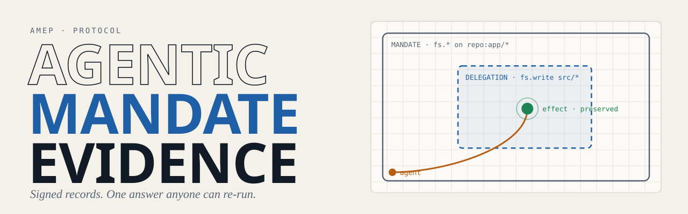
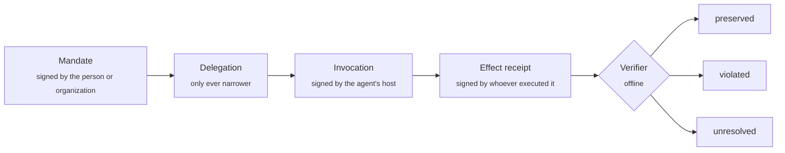

<picture>
  <source media="(prefers-color-scheme: dark)" srcset="docs/assets/banner-dark.svg">
  <source media="(prefers-color-scheme: light)" srcset="docs/assets/banner-light.svg">
  
</picture>

<h1 align="center">AMEP™ · Agentic Mandate Evidence Protocol</h1>

<p align="center"><b>Signed evidence that an AI agent stayed within the authority it was given,<br>and a verdict anyone can re-run.</b></p>

<p align="center">
  <a href="https://stafordtituss.github.io/amep/">Project site</a> ·
  <a href="https://stafordtituss.github.io/amep/verify/">Verifier in your browser</a> ·
  <a href="spec/amep-v0.2.md">Specification</a> ·
  <a href="https://datatracker.ietf.org/doc/draft-stafordtituss-agentic-mandate-evidence/">IETF draft</a> ·
  <a href="https://doi.org/10.20944/preprints202611.1865.v1">Paper</a>
</p>

<p align="center">
  <a href="https://doi.org/10.5281/zenodo.24317758"></a>
  <a href="https://pypi.org/project/amep-protocol/"></a>
  <a href="https://www.npmjs.com/package/@stafordtituss/amep"></a>
  <a href="LIMITS.md"></a>
</p>

---

**Contents:** [The question](#the-question) · [How it works](#how-it-works) · [Quick start](#quick-start) · [Checked in the open](#checked-in-the-open) · [In this repository](#in-this-repository) · [Standards and interop](#standards-and-interop) · [Limits](#limits) · [Help AMEP](#help-amep) · [Develop](#develop) · [Cite](#cite) · [License](#license-and-trademarks) · [Contact](#contact)

---

## The question

AI agents act for people through chains of delegation, tools and adapters. Identity tells you *who* acted, and authorization tells you what a token *allowed*. Neither shows that **what actually happened stayed within what a person authorized**.

AMEP defines signed records for each link of that chain, from a person's mandate to an independently observed effect, and one deterministic answer:

| Verdict | Meaning |
|---|---|
| **`preserved`** | What happened stayed inside what was allowed, at every step of the chain. |
| **`violated`** | It went outside. The result names the broken invariant and the party that departed first. |
| **`unresolved`** | A record is missing or can't be checked. The result names it. **A gap is never read as permission.** |

Two verifiers given the same records and keys return the same verdict, byte for byte.

## How it works



| Record | Says | Signed by |
|---|---|---|
| **Mandate** | Which actions, on which resources, up to which effect class, until when | The person or organization granting authority |
| **Delegation** | The part handed on to an agent, never more than its parent (I1) | The delegator |
| **Invocation** | The call the agent made, and the authority it cites | The agent's host |
| **Effect receipt** | What was actually executed | The executing party. For high-impact effects, not the agent's host (I10) |
| **Verdict record** | The outcome of every call, naming the packet by digest | Any verifier, as an in-toto attestation |

Eleven invariants decide the verdict. They are listed, with every rule, in the [specification](spec/amep-v0.2.md#8-invariants).

## Quick start

**In your browser, nothing to install:** the [verifier](https://stafordtituss.github.io/amep/verify/) runs the full conformance suite and checks any packet you paste in, offline, in the page.

**Install:**

| Use | Package | Install |
|---|---|---|
| Python 3.10+ | `amep-protocol` | `pip install --pre amep-protocol` |
| Node.js 20+ | `@stafordtituss/amep` | `npm install @stafordtituss/amep` |
| Any MCP client | `amep-mcp` | `uvx amep-mcp` |
| OpenAI Agents SDK, LangGraph | `amep-agents` | `pip install --pre "amep-agents[openai-agents]"` or `[langgraph]` |

**Check a packet:**

```bash
amep-protocol verify packet.json --keys keys.json      # exit 0 preserved, 1 violated, 2 unresolved
amep-protocol keygen --kid issuer-1 --roles issuer,approver --out issuer-1
amep-protocol check-suite vectors/
```

**Record an agent:** five runnable guides cover LangGraph, the OpenAI Agents SDK, saving and checking evidence, keeping the observer key away from the agent, and publishing a signed verdict. CI runs every one: [packages/agents/HOWTO.md](packages/agents/HOWTO.md).

## Checked in the open

| Who | What | Record |
|---|---|---|
| **Brennan Zambo** | An independent verifier, [zambo-amep-verify](https://github.com/zambodotdev/zambo-amep-verify), written from the specification and vectors alone. Agrees on all 228 single-packet core vectors. | [#19](https://github.com/stafordtituss/amep/issues/19) |
| **Takao Sato, VATE** | AMEP's evaluation of VATE's recovery cases, pinned to both projects and re-run by VATE's maintainer | [VATE `reference/amep/`](https://github.com/Poke-nushi/Verifiable-Agent-Trust-Envelope/tree/main/reference/amep) |
| **Agent Payments Protocol** | AMEP, AER-1 and APAF-1 run over the same pinned AP2 payments, joined row by row | [AP2 #402](https://github.com/google-agentic-commerce/AP2/issues/402) |
| **Reviewers** | Reviews that found real bugs, from the IETF audit list, the OpenID AIIM list, Zealynx Security and others | [REVIEWS.md](REVIEWS.md) · [CONTRIBUTORS.md](CONTRIBUTORS.md) · [vectors/CREDITS.md](vectors/CREDITS.md) |
| **A model of the hold rules** | Every reachable state at three calls, checked against the verifier | [`formal/`](formal/) |

## In this repository

| Path | Contents |
|---|---|
| [`spec/`](spec/) | The core specification, bindings (AuthZEN, MCP, agent hosts) and profiles (Biscuit, Macaroon, PASETO, UCAN, Verifiable Credentials) |
| [`vectors/`](vectors/) | The conformance suite: positive and must-reject packets. Also on Hugging Face: [stafordtituss/amep-conformance](https://huggingface.co/datasets/stafordtituss/amep-conformance) |
| [`schemas/`](schemas/) | JSON Schemas, one per object, and CDDL |
| [`packages/python/`](packages/python/) · [`packages/js/`](packages/js/) | The two reference verifiers, with SDK and command-line tool (written separately, by the same author) |
| [`packages/mcp/`](packages/mcp/) | The verifier and suites as MCP tools |
| [`packages/agents/`](packages/agents/) | Evidence for every tool call in OpenAI Agents SDK and LangGraph agents |
| [`packages/conformance/`](packages/conformance/) | Runs the suites against any verifier, and imports other formats (AER-1, OpenID action receipts, Provared, Observed Effect) with a gap report |
| [`verifier/browser/`](verifier/browser/) | The offline browser verifier |
| [`interop/`](interop/) | Mappings and runs against other work. [COVERAGE.md](interop/COVERAGE.md) shows which parts of AMEP's question each format can settle |
| [`proposals/`](proposals/) | Proposed changes: evaluation records, accountable owners, selective disclosure |
| [`ietf/`](ietf/) | The Internet-Draft, in Markdown with rendered XML, text and HTML |
| [`formal/`](formal/) | A TLA+ model of the hold and single-use rules, with an explorer that checks it against the verifier |

## Standards and interop

AMEP isn't an identity provider, a policy engine or a prompt-injection detector. It checks, afterwards, what those systems decided and what then happened, and composes with them:

| With | How | Notes |
|---|---|---|
| **IETF WIMSE** (agent identity) | Evidence for the Agent Compliance component of draft-ietf-wimse-aims | [interop/ietf/WIMSE-AIMS.md](interop/ietf/WIMSE-AIMS.md) |
| **IETF SCITT** (RFC 9943) | Verdicts as signed statements, beside action receipts | [interop/ietf/SCITT.md](interop/ietf/SCITT.md) |
| **in-toto** | Signed verdicts as an attestation predicate; completeness from Observed Effect records | [PREDICATE.md](interop/in-toto/PREDICATE.md) · [OBSERVED-EFFECT.md](interop/in-toto/OBSERVED-EFFECT.md) |
| **Agent Payments Protocol and x402** | Mandates, checkout binding, settlement as observed effect | [interop/ap2/](interop/ap2/) · [interop/x402/](interop/x402/NOTES.md) |
| **OpenID AuthZEN, MCP** | Decisions and tool calls as evidence | [`spec/bindings/`](spec/bindings/) |
| **OpenTelemetry GenAI** | Joining traces to evidence by id and digest | [interop/otel-genai/](interop/otel-genai/MAPPING.md) |
| **EU AI Act Article 12** | Signed, re-checkable event records for auditors | [interop/eu-ai-act/](interop/eu-ai-act/ARTICLE-12.md) |

<details>
<summary><b>Related work</b></summary>

AMEP evaluates evidence *after* authority has been granted and exercised. Related work, mostly on granting and checking authority *before* an action:

- **Delegation Receipt Protocol** ([draft-nelson-agent-delegation-receipts](https://datatracker.ietf.org/doc/draft-nelson-agent-delegation-receipts/), R. Nelson). A user-signed Authorization Object, anchored before the agent runs and checked before execution. A DRP receipt is a natural mandate input for AMEP.
- **Authenticated Delegation and Authorized AI Agents** ([arXiv:2501.09674](https://arxiv.org/abs/2501.09674), South et al., 2025). Scoped, verifiable delegation credentials for agents, extending OpenID Connect and OAuth 2.0.
- **Infrastructure for AI Agents** ([arXiv:2501.10114](https://arxiv.org/abs/2501.10114), Chan et al., TMLR 2025) and **IDs for AI Systems** ([arXiv:2406.12137](https://arxiv.org/abs/2406.12137), Chan et al., 2024). Attribution and response infrastructure; AMEP's evidence is one form of it.
- **DIF Threat Model for Delegated Authority in AI-Mediated Systems** ([identity.foundation](https://identity.foundation/delegated-authority-threat-model/)) and **DIF Delegated Authority Evaluations** ([identity.foundation](https://identity.foundation/delegated-authority-evaluations/)), Trusted AI Agents Working Group.
- **NIST NCCoE, Software and AI Agent Identity and Authorization** ([concept paper, 2026](https://www.nccoe.nist.gov/projects/software-and-ai-agent-identity-and-authorization)).
- **GNAP** ([RFC 9635](https://www.rfc-editor.org/rfc/rfc9635)). Delegated authorization negotiation across multiple parties.
- **AgentDojo** ([arXiv:2406.13352](https://arxiv.org/abs/2406.13352)) and **CaMeL** ([arXiv:2503.18813](https://arxiv.org/abs/2503.18813)), Debenedetti, Tramèr et al. A successful prompt injection is an effect outside the user's mandate, which AMEP reports as `violated`.

</details>

## Limits

What AMEP can't show is written down, and each limit is pinned by a vector or a test: **[LIMITS.md](LIMITS.md)**. The main ones:
- **A signer that lies consistently can't be caught;** contradictions between signed records can.
- **An effect nobody recorded can't be seen,** except where an observer below the agent covers it (Observed Effect).
- **Verifiers say what the evidence shows,** not whether the authority itself was wise.

## Help AMEP

AMEP needs outside scrutiny more than anything else.

**Five minutes:** run the suite in the [browser verifier](https://stafordtituss.github.io/amep/verify/), star the repository if it's useful, or [open an issue](https://github.com/stafordtituss/amep/issues/new/choose) with a case you think AMEP gets wrong. Every case that turns out to be right becomes a vector with your name on it.

**Longer, and worth the most:**
1. **Run it against your own system,** publish the results (failures included), and open an [implementation report](https://github.com/stafordtituss/amep/issues/new?template=implementation-report.yml).
2. **Write a port.** A Go or Rust verifier written from the specification and vectors alone would be a further independent implementation. It will be listed and credited ([#18](https://github.com/stafordtituss/amep/issues/18)).
3. **Review it in public:** an [independent technical review](https://github.com/stafordtituss/amep/issues/new?template=independent-review.yml), or a comment on an IETF, W3C, DIF or OpenID Foundation list.
4. **Cite it where relevant:** if your draft, paper or specification overlaps, an informative reference or a note on where the approaches differ is welcome.

Every review, implementation and citation is logged as written, critical ones included, in [REVIEWS.md](REVIEWS.md).

## Develop

```bash
python3 -I verifier/python/amep_verifier.py                 # regenerate the vectors and check them
python3 -I verifier/python/amep_verifier.py --check vectors # check the vectors as committed
node verifier/typescript/amep_verifier.mjs vectors          # the JavaScript verifier on the same vectors
node verifier/browser/build.mjs && node verifier/browser/test_page.mjs
python3 tools/validate_schemas.py
python3 -I tools/validate_cddl.py                           # needs: gem install cddl
python3 -I tools/vector_index.py --check
```

CI runs all of these on every push and pull request, and fails if the committed vectors, schemas or browser page differ from what the generators produce.

**Changing the specification:** open an issue, then an `AMEP-Proposal-N` document in [`proposals/`](proposals/). Every normative change needs at least one positive and one must-reject vector. See [CONTRIBUTING.md](CONTRIBUTING.md), [RESEARCH.md](RESEARCH.md) for open problems, and [CHANGELOG.md](CHANGELOG.md).

## Cite

The Zenodo DOI always resolves to the latest version. GitHub's **Cite this repository** button, from [CITATION.cff](CITATION.cff), gives the same entries.

<details>
<summary><b>BibTeX</b></summary>

```bibtex
@software{selvaraj2026amep,
  author    = {Selvaraj, Staford Titus},
  title     = {{AMEP}: Agentic Mandate Evidence Protocol},
  year      = {2026},
  publisher = {Zenodo},
  doi       = {10.5281/zenodo.24317758},
  url       = {https://github.com/stafordtituss/amep}
}

@techreport{selvaraj2026amepdraft,
  author      = {Selvaraj, Staford Titus},
  title       = {Continuity Evaluation of Agent Delegation Records},
  type        = {Internet-Draft},
  number      = {draft-stafordtituss-agentic-mandate-evidence-01},
  institution = {Internet Engineering Task Force},
  year        = {2026},
  month       = nov,
  url         = {https://datatracker.ietf.org/doc/draft-stafordtituss-agentic-mandate-evidence/}
}

@misc{selvaraj2026ameppaper,
  author = {Selvaraj, Staford Titus},
  title  = {{AMEP}: Verifiable Evidence That Agent Actions Stayed Within Delegated Authority},
  year   = {2026},
  note   = {Preprint},
  doi    = {10.20944/preprints202611.1865.v1}
}
```

</details>

## License and trademarks

- **Specification text:** Community Specification License 1.0 ([LICENSE-SPEC.md](LICENSE-SPEC.md)), with [Scope.md](Scope.md) and [Notices.md](Notices.md). Derivative works must credit the AMEP project and its original author. The license calls the project its "Working Group"; AMEP is an open-source project, not a standards-body working group.
- **Code, schemas and vectors:** Apache License 2.0 ([LICENSE-CODE](LICENSE-CODE)). Redistributions must keep [NOTICE](NOTICE).
- **Trademarks:** "AMEP" and "AMEP Conformant" are trademarks of Staford Titus Selvaraj ([TRADEMARKS.md](TRADEMARKS.md)). Forks are welcome under a different name.

## Contact

- **Questions, bugs and proposals:** [open an issue](https://github.com/stafordtituss/amep/issues/new/choose). Public discussion helps everyone who reads the repository later.
- **Reviews and implementation reports:** the [review](https://github.com/stafordtituss/amep/issues/new?template=independent-review.yml) and [implementation report](https://github.com/stafordtituss/amep/issues/new?template=implementation-report.yml) forms.
- **Security issues in the verifiers:** a [private security advisory](https://github.com/stafordtituss/amep/security/advisories/new), not a public issue.
- **Author and editor:** Staford Titus Selvaraj · [ORCID 0009-0004-8227-7595](https://orcid.org/0009-0004-8227-7595)
